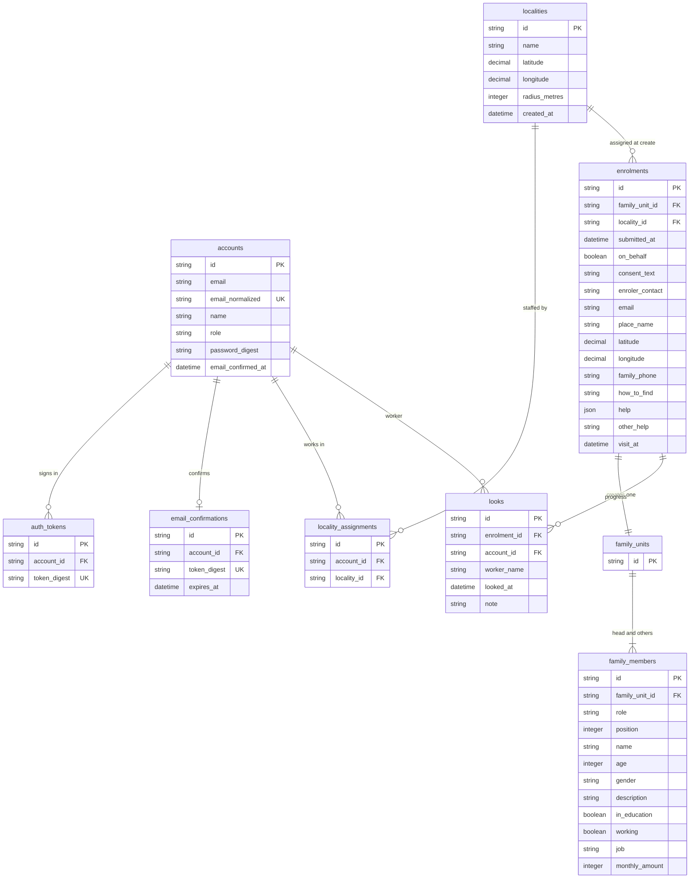
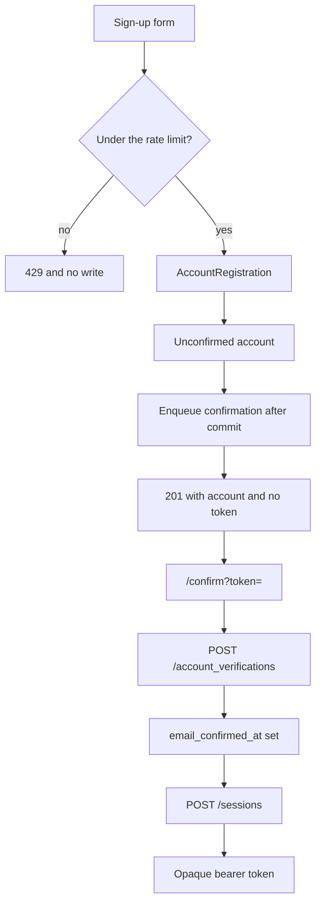
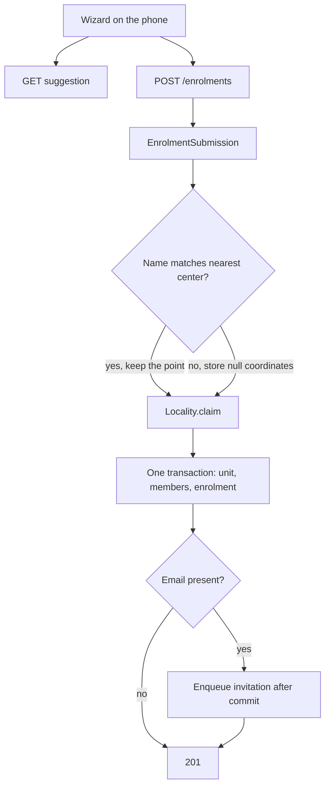
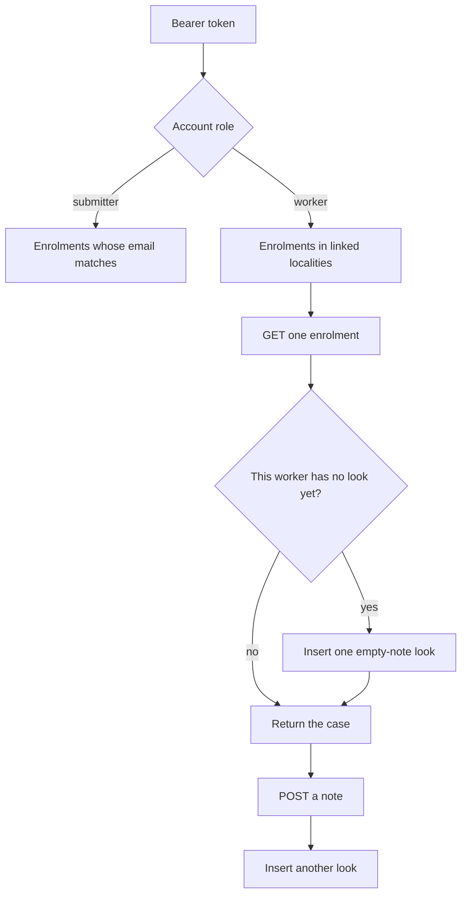

# Implementation Plan: Enrolment

## Overview

A person with a phone can submit one enrolment for a family, for themselves or for someone else, without an account. The API saves the family, assigns one locality, and queues a single invitation when an email was given. A submitter who later signs up with that email confirms the inbox, signs in, and can see that the case is in, who has looked, and that no visit is set. A community worker linked to the locality can open the case, leave a note, and set the locality's center and radius.

Tasks 1–5 are already on `feature/enrolment`. This revision replaces the account contract from Task 6 on. [Pull request #12](https://github.com/usamah82/sokong/pull/12) implemented the old sign-up response and must not merge. Flutter is a later spec. The approved contract is [spec.md](spec.md). The pictures are [design.md](design.md).

Checkboxes live in [tasks.md](tasks.md). This file is the index and the decisions. There are 27 tasks. Usamah approved the revised spec and this plan on 2026-11-11.

On 2026-11-03 Usamah confirmed SQLite with UUID strings, the stored consent sentence, a worker linked to more than one locality, the token digest, and the coordinate rule.

## Architecture Decisions

- **Ids are UUID strings generated in Ruby.** `ApplicationRecord` sets `id` to `SecureRandom.uuid` on create. Migrations use `id: false` and `t.string :id, limit: 36, null: false, primary_key: true`. Foreign keys are the same string type, written out explicitly. SQLite has no UUID column type, and a gem for one would need a separate ask. Order lists and tie-breaks by `submitted_at` or `created_at`, and set `implicit_order_column` to `created_at`.
- **One plain object validates the enrolment body.** `EnrolmentSubmission` under `backend/app/models/` checks types and limits and returns the error envelope. The controller calls it and stays thin. `Locality.claim` stays the fit rule from the spec. Active Record saves the cleaned result inside one transaction.
- **The server stores the consent sentence.** `on_behalf` false stores "Submission means the family consents. That consent is confirmed at the verification visit." `on_behalf` true stores "This case is valid and will be checked at a visit. It may not be enrolled unless the family consents then." A client-sent `consent_text` is ignored. The web shows the same two strings from `web/i18n/locales/en.json`.
- **A kept point is a later slice of the same save.** Until the nearest-center task, `POST /enrolments` stores `latitude` and `longitude` as null. That task then keeps the pair only when the place name matches the nearest locality that already has a center.
- **Distance is haversine in Ruby.** Mean Earth radius `6_371_000` metres. A point is inside a circle when distance to the center is less than or equal to `radius_metres`. Equal distance is tested with identical centers. The suggestion endpoint has no radius cutoff and considers only localities that have a center.
- **Place names.** The stored name is stripped, with internal whitespace collapsed to a single space, and the submitter's casing kept. Matching casefolds with `downcase(:fold)` and compares that collapsed form.
- **Phones.** Remove spaces, hyphens, dots, and parentheses, then require `^\+?[0-9]{8,15}$`. Store the remainder.
- **JSON types.** Age and monthly amount must be JSON integers. Gender is `male`, `female`, or `unspecified`. `in_education` and `working` must be JSON booleans when present; a missing key is false. Help keys are `food`, `clothing`, `school_supplies`, and `help_applying`, stored once in first-seen order. Each member has `role` of `head` or `member`, with exactly one head. The response lists the head first, then submission order.
- **Accounts.** Public `POST /accounts` always persists `role: "submitter"` and ignores a `role` field. It returns `account` and no `token`. Email is stored trimmed, with the submitter's casing, plus `email_normalized` (stripped and casefolded) under a unique index. `email_confirmed_at` is null until the confirmation token is accepted. Password uses `has_secure_password` after uncommenting `bcrypt` already named in the Gemfile. Length is at least 12 characters and at most 72 bytes. A non-string password or a null byte is `422` before bcrypt runs. Until the confirmation task, any existing email is `422`. That task then keeps an unconfirmed account, however recent, replaces its password, and invalidates the previous confirmation token. A confirmed email stays `422` and its digest does not change.
- **Confirmation.** Table `email_confirmations`. The raw token is a `SecureRandom.urlsafe_base64(32)` carried once in the mail link as `http://localhost:3001/confirm?token=`. The row stores `Digest::SHA256.hexdigest` and `expires_at` 24 hours out. Each new message replaces the previous row, so only the latest link works. `POST /account_verifications` sets `email_confirmed_at` and deletes the row. It returns `204` and no session token. A miss is `422` with "Confirmation link is invalid".
- **Sessions.** Table `auth_tokens`, created at sign-in, not at sign-up. The raw bearer token is returned once from `POST /sessions`, and only when `email_confirmed_at` is set. The row stores `Digest::SHA256.hexdigest`. The token stays valid until `DELETE /sessions` destroys the row. The web keeps the raw token in `sessionStorage` under `sokong.token`. `POST /enrolments` does not read it.
- **Rate limits.** A plain object `RequestRateLimit` counts `request.remote_ip` in `Rails.cache` before a password is hashed and before mail is queued. No new gem. `POST /accounts` allows 5 requests per hour. `POST /sessions` allows 10 per 15 minutes. `POST /account_verifications` allows 10 per hour. The next request is `429` with `RATE_LIMITED` and changes nothing. `POST /enrolments` is not counted. Tests use the memory store and travel the clock.
- **A worker may be linked to more than one locality.** `locality_assignments` is the link. The worker's list is the enrolments in every linked locality, newest `submitted_at` first. A worker with no link receives `403` with code `FORBIDDEN` and message "No locality is linked to this account." A linked worker with no enrolments receives `200` and an empty array; the web says "No enrolments yet."
- **Looks.** The first authorized detail read inserts one look with an empty note when that worker has no look on that enrolment yet. Opening the list does not. `POST /enrolments/:id/looks` always appends a look. `worker_name` is copied from the account at that moment. `visit_at` stays null.
- **Mail.** `EnrolmentMailer` subject "Sokong enrolment" and body "An enrolment was received. Sign up with this email address to see whether anyone has looked and whether a visit is set." `AccountMailer` subject "Confirm your Sokong email" and body "Confirm this email address to sign in to Sokong. If you did not sign up, ignore this message." followed by the one confirmation link. Neither body contains a family name, place, phone, contact, or help. From address stays the existing `from@example.com`. `deliver_later` runs after the enrolment or account transaction commits. An enqueue failure is rescued and the response is still `201`. Test environment sets `config.active_job.queue_adapter = :test`. A look or a note sends no mail. `sokong:worker` sets `email_confirmed_at` and queues no confirmation.
- **Errors.** Validation is `422` with `VALIDATION_ERROR` and the spec's `details` object. A missing or unknown token, and a wrong sign-in, are `401` with `UNAUTHENTICATED`. Wrong sign-in uses message "Email or password is wrong". The correct password on an unconfirmed account uses "Confirm your email to sign in". A missing token uses "Sign in is required". An authenticated caller who must not see a record, including an unknown id, is `404` with `NOT_FOUND`, message "Not found", and no `details`. A rate limit is `429` with `RATE_LIMITED` and message "Too many attempts. Try again later." These messages are already in `spec.md`. Tasks do not edit `spec.md`.
- **CORS.** Uncomment `rack-cors`, already named in the Gemfile. Allow `http://localhost:3001` only.
- **Web.** npm, because the spec's commands are `npm`. `nuxi@latest` scaffolds `web/`. `@nuxtjs/i18n` uses `defaultLocale: "en"`, strategy `no_prefix`, and the only locale file `web/i18n/locales/en.json`. Pages live at `web/pages/` as the spec says; the scaffold task checks the current Nuxt `srcDir` docs and sets them so that path is true. Dev server port `3001`. Vitest and the lint script Nuxt's scaffold provides are the allowed test setup. No component library. Every screen uses the tokens in `design.md`. Screens without a picture use that same type scale and those same colors.
- **Routes in the web app.** `/` is the wizard. Confirmation is the next view after `201`, holding the response in memory. `/sign-up`, `/confirm`, `/sign-in`, `/enrolments`, `/enrolments/:id`, and `/localities/:id`. Sign-up does not write `sessionStorage`. `/confirm` reads the query token and posts it. Sign-in writes `sokong.token`. The API base is `http://localhost:3000` via Nuxt public runtime config.
- **CI.** Root `bin/ci` keeps the Rails gate, then runs `npm test` and `npm run lint` in `web/` once that app exists. The GitHub workflow gains a web job in the same task so a pull request runs the same checks. Until that task, `bin/ci` remains the Rails gate.
- **Tests build their own rows.** No fixture YAML and no factory gem. Integration tests are the HTTP proof the spec names. Model tests carry the fit rule before a route exists.

## Technical map

Tasks 1–5 already created localities, assignments, families, and enrolments. `GET /up` stays. Every id below is a UUID string. An enrolment finds its submitter by email. There is no foreign key from `enrolments` to `accounts`.



`EnrolmentSubmission` validates the body and is not a table. `AccountRegistration` does the same for sign-up. `Locality.claim` picks or creates the locality. `EnrolmentMailer` sends the one invitation. `AccountMailer` sends the confirmation. `RequestRateLimit` is not a table. Rails timestamps sit on the tables that need ordering. `visit_at` is always null in this feature. `email_confirmed_at` stays null until the confirmation token is accepted.

| Method and path | Who | What it writes |
|---|---|---|
| `GET /localities/suggestion` | anonymous | nothing |
| `POST /enrolments` | anonymous | locality if none fits, family unit, members, enrolment, and maybe one queued mail |
| `POST /accounts` | anonymous | unconfirmed submitter, and maybe one queued confirmation |
| `POST /account_verifications` | anonymous | sets `email_confirmed_at` and deletes that confirmation row |
| `POST /sessions` | anonymous | one token digest, only for a confirmed account |
| `DELETE /sessions` | bearer | destroys that token |
| `GET /enrolments` | bearer | nothing |
| `GET /enrolments/:id` | bearer | one empty-note look on the worker's first open |
| `POST /enrolments/:id/looks` | linked worker | one look with the note |
| `PATCH /localities/:id` | linked worker | that locality's name, center, and radius |

`GET /up` is unchanged. `sokong:worker`, `sokong:locality`, and `sokong:assign` are rake commands, not routes. The phone pages are `/`, `/sign-up`, `/confirm`, `/sign-in`, `/enrolments`, `/enrolments/:id`, and `/localities/:id`.







A later edit to a locality's name or circle does not move an enrolment already saved. A list read does not insert a look. A look or a note does not send mail.

## Task List

The task list target is [tasks.md](tasks.md). Implement the next unchecked task there. A `Checkpoint` heading is a review gate: check it after the tasks above it, and do not open a pull request for the checkpoint itself.

### Phase 1: Save an enrolment

- Task 1: Locality claim
- Task 2: Enrolment records
- Task 3: Accept an enrolment over HTTP

### Checkpoint: Anonymous submit

- A valid body creates one enrolment, one family unit, and one head. Invalid bodies return `422` and save nothing. `GET /up` still succeeds.

### Phase 2: Place and invitation

- Task 4: Nearest locality with a center
- Task 5: Queue the invitation

### Checkpoint: Place and mail

- A matching place name keeps the device point. Any other name clears it. An email enqueues one invitation with no family details.

### Phase 3: Confirm, then sign in

- Task 6: Create an unconfirmed submitter
- Task 7: Confirm the email
- Task 8: Sign in and sign out
- Task 9: Rate-limit sign-up, confirmation, and sign-in
- Task 10: Submitter reads progress

### Checkpoint: Submitter can read

- Sign-up is still optional for submit and returns no token. A confirmed matching account can sign in and sees the case in, an empty look list, and no visit. An unconfirmed account cannot. Anyone else receives `401` or `404`.

### Phase 4: Worker access

- Task 11: Record a worker's first look
- Task 12: Add a worker note
- Task 13: Update a locality boundary
- Task 14: Operator commands

### Checkpoint: Worker API

- The linked worker sees the family. The first detail read stores one look. A note shows on the submitter's progress. `visit_at` stays empty. Locality edits do not move saved enrolments. The operator command creates a confirmed worker and sends no confirmation mail.

### Phase 5: Phone form

- Task 15: Allow the web origin
- Task 16: Scaffold the Nuxt app
- Task 17: Who is enrolling
- Task 18: Record the family and the head
- Task 19: Suggest the place from the device
- Task 20: Other people in the family
- Task 21: Submit the enrolment and show confirmation

### Checkpoint: Phone form

- The four stages run in order at 390 CSS pixels wide. Back keeps typed values. Submit shows that the case is in and that no visit is set.

### Phase 6: Accounts on the phone

- Task 22: Sign-up page
- Task 23: Email confirmation page
- Task 24: Sign-in page
- Task 25: Submitter progress page
- Task 26: Worker cases page
- Task 27: Locality boundary page

### Checkpoint: Complete

- `bin/ci` is green, including the web test and lint scripts.
- The browser pass holds at 390 CSS pixels: each wizard stage, the enrolment confirmation, sign-up, email confirmation, sign-in, submitter progress, and the worker case.
- Ready for a review session.

## Dependency Graph

```
Task 1 Locality claim
  └─ Task 2 Enrolment records
       └─ Task 3 POST /enrolments
            ├─ Task 4 nearest center and suggestion
            ├─ Task 5 invitation
            └─ Task 6 unconfirmed account
                 └─ Task 7 email confirmation
                      └─ Task 8 sessions
                           ├─ Task 9 rate limits
                           ├─ Task 10 submitter progress
                           ├─ Task 11 first look
                           │    └─ Task 12 notes
                           ├─ Task 13 locality PATCH
                           └─ Task 14 operator commands
Task 15 CORS (after Task 3)
  └─ Task 16 Nuxt shell
       └─ Task 17 stage 1
            └─ Task 18 stage 2
                 └─ Task 19 device suggestion (needs Task 4)
                      └─ Task 20 stage 3
                           └─ Task 21 submit (needs Task 3)
Task 16 + Task 7 → Task 22 sign-up page
Task 22 + Task 7 → Task 23 confirmation page
Task 23 + Task 8 → Task 24 sign-in page
Task 24 + Task 10 → Task 25 progress page
Task 24 + Tasks 11–12 → Task 26 worker page
Task 24 + Task 13 → Task 27 boundary page
```

Tasks 4 and 5 can be built in either order after Task 3. The web tasks stay in the order above because they share the wizard's saved answers. Do not start Task 6 from pull request #12.

## Parallelization Opportunities

This repo runs one implementation session at a time, and each session takes the next unchecked task. After the worker API checkpoint, Task 15 (CORS) is the only task that can start without waiting on Tasks 11–14. Do not split the wizard across concurrent sessions: stages 17–21 share one form state.

## Risks and Mitigations

| Risk | Impact | Mitigation |
|------|--------|------------|
| The fit rule picks the wrong locality when several circles overlap | High | Task 1 is a model test of every branch in the spec before any route can save the wrong id. Rollback is reverting that task. |
| A public route accepts a worker role or a bad member and still saves | High | `POST /enrolments` and `POST /accounts` land with their rejection tests in the same task. A role field still creates a submitter. Sign-up returns no token. |
| Sign-up returns a token before the inbox is confirmed | High | Task 6's response has no `token` key. Task 8 returns one only when `email_confirmed_at` is set. Pull request #12 is not a starting point. |
| A flood of sign-ups holds the database pool inside bcrypt | Medium | Task 9 counts the client IP before hashing and before mail, and returns `429` with no write. |
| An unconfirmed sign-up keeps the first caller's password | High | Task 7 replaces the password and the confirmation token on every unconfirmed repeat sign-up, however recent the account is. A confirmed email is not replaced. |
| SQLite parallel tests lock on the new writes | Medium | Keep `parallelize` in the test helper. If a new test flakes on a lock, make that test file run serially. Leave the helper's parallel setting in place for the rest of the suite. |
| Nuxt 4's default `app/` directory drifts from `web/pages/` in the spec | Medium | The scaffold task reads the current Nuxt `srcDir` docs and configures `web/pages/`. If the framework cannot do that, the task updates `spec.md` with the real path and stops for a look. |
| The scaffold pulls in a UI kit or extra runtime | Medium | The task allows `@nuxtjs/i18n`, Vitest, and the lint tool the scaffold already adds. Any other dependency waits for an ask. |
| Mail enqueue raises and rolls back the enrolment | Medium | Enqueue after commit, rescue the enqueue error, and prove with a test that the row remains and the response is `201`. |
| Intermediate tasks store coordinates as null | Low | Task 3 does that on purpose. Task 4 is the one that starts keeping a matching point. The feature is not done between them. |
| GitHub Actions stays Rails-only after `web/` exists | Medium | The scaffold task adds the web job in the same change as root `bin/ci`. |

## Open Questions

None. The spec's open questions are closed. The decisions above are the implementation choices. Correct any of them before plan approval.

## Rollback

Each task is one pull request into `feature/enrolment`. Revert the latest task's pull request to undo it. Later tasks name the earlier task they depend on, so revert from the tip of the chain. A wrong locality assignment shows up as `locality_id` in the Task 1 and Task 3 tests, before a worker can act on it. Pull request #12 is discarded rather than reverted, because it never merged.
