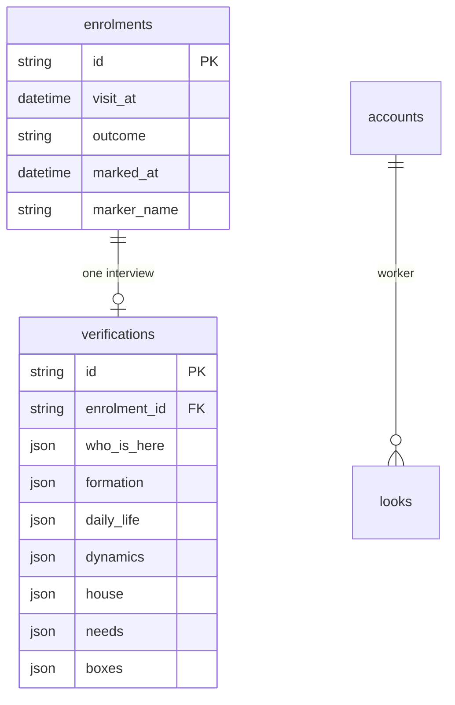
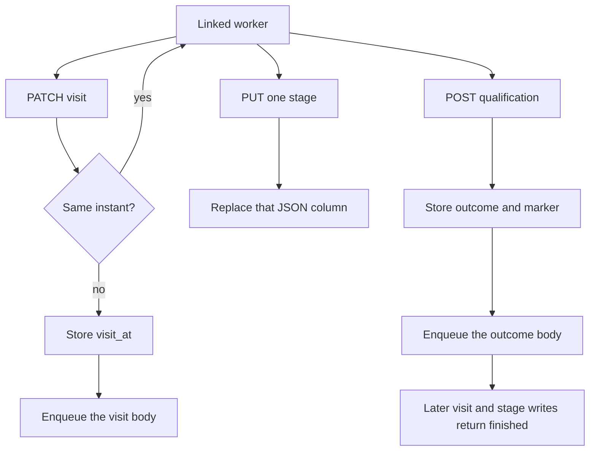

# Implementation Plan: Verification visit

## Overview

A linked community worker sets the first visit, interviews the family in seven stages, and marks the family qualified or disqualified. The person who enrolled sees the visit time and, later, the outcome. When the enrolment has an email, that address receives the visit message and the outcome message. Each message names the head and the place.

The approved contract is [spec.md](spec.md). The pictures are [design.md](design.md). Checkboxes live in [tasks.md](tasks.md). This file is the index and the decisions. There are 21 tasks.

This plan sits on the spec branch for [pull request #41](https://github.com/usamah82/sokong/pull/41). Implementation starts from `main` after that pull request and this plan are merged. The feature branch is `feature/verification-visit`. Run creates it. No new gem, no npm dependency, no CORS change, and no Flutter app. `GET /up` stays as it is.

A visit can be stored before its mail exists, and a mark can be stored before the outcome mail exists. The worker case gains one stage group at a time. The feature is complete at the last checkpoint, not between tasks.

## Architecture Decisions

- **Ids stay UUID strings.** `verifications.id` uses the same `ApplicationRecord` assignment as every other table. The foreign key `enrolment_id` is a 36-character string with a unique index. One enrolment has one verification row.
- **The visit time is the existing `visit_at` column.** `Enrolment#schedule_visit` parses the body. A stored outcome makes every later call return `:finished` before the new value is parsed, so a bad body still changes nothing. A value that parses is accepted in the past and more than seven days after `submitted_at`. Seven days is `7 * 24` hours, compared as instants. The same instant, truncated to a whole second, returns `:unchanged` and does not write. Any other parseable instant is stored in UTC with microseconds cleared. The response is that value with a `Z`.
- **A visit value is a string with a date, a time, and a zone.** The zone is `Z` or `±hh:mm`. `Time.iso8601` must accept it. A date with no time, a time with no zone, and an impossible date return `:visit_invalid`. `2026-11-24T09:00:00+08:00` is stored as `2026-11-24T01:00:00Z`.
- **The outcome is three columns on `enrolments`.** `outcome` is null until the mark, then `qualified` or `disqualified`. `marked_at` is the server time. `marker_name` is the worker account's name at that moment, copied onto the row. There is no second write.
- **The interview is one `verifications` row.** Seven JSON columns: `who_is_here`, `formation`, `daily_life`, `dynamics`, `house`, `needs`, `boxes`. Null means that stage has not been saved. A saved stage is a JSON object, including a stage whose answers are blank. Saving a stage replaces that column and leaves the other columns as they were.
- **Each stage has a plain object.** `WhoIsHereStage`, `FormationStage`, `DailyLifeStage`, `DynamicsStage`, `HouseStage`, `NeedsStage`, and `BoxesStage` live in `backend/app/models/`. Each accepts the params, returns an error envelope, or returns the cleaned hash. `Verification#save_stage` picks the object, stores the hash, and sets `worker_name` and `recorded_at` on that hash. Client-sent copies of those two keys are ignored. Unknown keys are dropped.
- **Strings are stripped at the ends and otherwise kept.** Limits apply after that strip. Phone uses the enrolment rule: remove spaces, hyphens, dots, and parentheses, then require `\A\+?[0-9]{8,15}\z`, and store the remainder. Numbers are JSON integers. `1.0` and `"8"` are invalid. Booleans are JSON `true`, `false`, or `null`. A follow-up the answer does not open is stored empty on a successful save: `""` for text, `null` for a number or a boolean.
- **The stage response is the stored object.** `PUT` returns that object, including `worker_name` and `recorded_at`, with no wrapper. `recorded_at` is UTC ISO 8601. Worker detail includes `verification: null` until the first stage is saved. After that, `verification` has all seven keys, and an unsaved stage is null. The submitter body has no `verification` key. Worker list items gain `visit_at` and `outcome` and do not gain the interview.
- **Kept people are fixed at mark time.** A kept person is every enrolment member, head first and then `position`, plus every visit-added person in the saved `who_is_here.people` array. An enrolment member missing from that array has no identity choice. A blank people array can still be saved. The mark then fails for each enrolment member. Visit-added people are not the head. The head is the enrolment member whose role is `head`.
- **`person_id` is a client UUID.** Every person object on Who is here and A day in their life carries one. An enrolment member also carries `family_member_id`. A visit-added person has `family_member_id: null`. The web generates `person_id` once and reuses it. Daily life does not have to list the same people for the stage to save. The mark does not require a daily-life row per person.
- **The mark order follows the success criteria.** `Enrolment#mark` returns a symbol, or nil after it saves. The order is: outcome missing, outcome outside the two values, visit missing, outcome already stored, then the first interview gap, then qualified with consent false. A second mark is "The mark is already set" even when consent is false. `VerificationMessages` maps each symbol to the envelope. Controllers render that envelope and do not contain the rule.
- **An unsaved stage and a bad field use different messages.** The first unsaved stage, in the seven-stage order, is message "The visit record is incomplete" and `details` of that stage key with `["is required"]`. A saved interview with a bad or missing mark field uses the field sentence below, and `message` is that sentence. Qualified with consent false is "The family has not consented" and `details.outcome` of `["needs consent"]`.
- **Mail text is fixed when it is queued.** `EnrolmentMailer` gains `visit_arranged(email, body)` and `verification_result(email, body)`. The subject is fixed in the method. The body is an argument, so a later visit change does not rewrite a message already queued. The mailer keeps `EnrolmentInvitationDeliveryJob`, which already sets `log_arguments = false`. The job log must not contain the head, the place, or the email. The rendered visit and outcome bodies do contain the head and the place. The month names are a frozen English list in the mailer, so the server locale cannot change "November". Enqueue runs after the save, and a raised enqueue is rescued. The log line is the error class only. The saved row and the HTTP status stay.
- **The same linked-worker lookup as a note.** Anonymous is 401 with "Sign in is required". A submitter, a worker of another locality, an unlinked worker, and an unknown id are 404 with "Not found" and no `details`. An unknown stage name is 404 after the enrolment is found. These routes do not use the list's 403.
- **The web reuses the paper styles.** Copy is read with `t()` from `web/i18n/locales/en.json`. The visit field is `datetime-local`. The page converts that local value to UTC ISO 8601. Empty or unparseable input shows "Visit time is invalid" and does not send. `formatVisit` lives in `web/utils/visitTime.ts`. It formats with `en-GB` and `hourCycle: "h23"` as `24 November 2026 at 09:00`. The page uses the browser zone. The test calls it with `Asia/Kuala_Lumpur` so the UTC+8 sentence is fixed in CI. The `<time datetime>` is the API value.
- **Inside a stage, switching person does not save.** Who is here and A day in their life save the whole stage when Back, Next, or the stage list leaves it. A stage whose component is not built yet can be opened and does not send a PUT. From the first interview task, all seven names are on the list.
- **Read-only is a prop from the start.** Each stage component accepts `readonly`. The mark task sets it when `outcome` is present, and hides Set visit, Change visit, Back, Next, Add a person, and both mark actions. The stage list still opens each stage as text. The existing member list, help, looks, and note form stay.

## Stage contract

Limits are after trim. A failed PUT does not change the stored column. The first error's message is the envelope `message`. The objects collect every field error, in the order the fields are listed here.

### Who is here — `who_is_here`

```json
{
  "people": [],
  "others_stay": null,
  "others_stay_detail": "",
  "care_for_parents": null,
  "care_for_parents_detail": "",
  "notes": ""
}
```

Each person:

| Key | Stored value |
|---|---|
| `person_id` | UUID string. Required. Duplicates are "Person is invalid". |
| `family_member_id` | This enrolment's member id, or null for a person the visit added. A duplicate or an unknown id is "Person is invalid". |
| `head` | `true` only for the enrolment head. Any other `true`, or `false` on the included head, is "Relationship is invalid". |
| `name` | 1–200 characters. "Full name is required", "Full name is too long", or "Full name is invalid". |
| `birth_date` | `""` or a real `YYYY-MM-DD`. "Birth date is invalid". |
| `gender` | `""`, `male`, `female`, or `unspecified`. |
| `phone` | `""` or the normalised phone. The message is "Enter a phone number, for example +60 12-345 6789." |
| `identification` | 0–200. |
| `origin` | 0–200. Stored as `""` when `relationship` is `child`. |
| `relationship` | `""` for the head. Otherwise `""`, `spouse`, `child`, `parent`, or `other`. |
| `identity` | `""`, `verified`, `not_verified`, or `no_papers`. |
| `absent` | `true`, `false`, or `null`. |
| `absent_since` | `""` unless `absent` is `true`, then `""` or a real `YYYY-MM-DD`. |
| `absent_reason` | `""` unless `absent` is `true`. 0–2000. |

`others_stay_detail` is stored as `""` unless `others_stay` is `true`. `care_for_parents_detail` is stored as `""` unless `care_for_parents` is `true`. `notes` is 0–2000. `details.person_id` is `["is invalid"]` for a bad person reference. `details.name` and `details.phone` follow the enrolment shape.

### How the family formed — `formation`

`started_year` is a JSON integer from 1900 through the current UTC year, or `null`. Any other value uses message "Enter the year, for example 2008." and `details.started_year` of `["is invalid"]`. `how_it_started` and `notes` are 0–2000.

### A day in their life — `daily_life`

`people` is an array. An empty array is a saved blank stage. Each item has `person_id`, `working`, `job`, `monthly_amount`, `previous_jobs`, `wished_work`, `skills`, `in_school`, `school_going`, `school_where`, and `school_travel`. `working` and `in_school` are booleans or null. Unless `working` is `true`, the job, the amount, previous jobs, and wished work are stored empty. `skills` stays either way, 0–2000. Unless `in_school` is `true`, the three school answers are stored empty. `job` and `school_where` are 0–200. `monthly_amount` is null or an integer from 0 through 999999999. The long text fields are 0–2000.

### How they are together — `dynamics`

`hard_week`, `who_steps_in`, `children_at_home`, and `notes` are 0–2000. `children_at_home` is stored as `""` when the saved Who is here has no person with relationship `child`, and when Who is here has not been saved.

### The house and the meals — `house`

`place` is `""`, `own`, `rent`, `staying_with_someone`, or `temporary`. Unless `place` is `rent`, `rent_per_month` is null and `behind_on_payments` is null. `has_water`, `has_electricity`, `behind_on_payments`, and `safe` are booleans or null. `unsafe_detail` is stored as `""` unless `safe` is `false`. `sleeping_rooms` is null or an integer from 0 through 99. `rent_per_month` is null or an integer from 0 through 999999999. `meals` is `""`, `three`, `two`, `one`, or `not_every_day`. `basket` is `""` or 1–500. `notes` is 0–2000. A bad place or a bad meals value is "{label} is invalid".

### What they need — `needs`

`need_most` and `notes` are 0–2000. `consent_given` is `true`, `false`, or `null`. A non-boolean is "Consent is invalid".

### Initial assessment — `boxes`

`good_family_unit` and `basic_necessities` are booleans or null. Both gap strings are stored as sent, 0–2000. `notes` is 0–2000. The gaps are not follow-ups.

### Mark-time field order

1. Basket blank: "Basket is required", `details.basket` `["is required"]`.
2. Basket longer than 500: "Basket is too long".
3. Consent null: "Consent is required", `details.consent_given` `["is required"]`.
4. The first kept person with no identity: "Identity check is required", `details.identity` `["is required"]`. A value outside the three is "Identity check is invalid".
5. The first kept person other than the head with no relationship: "Relationship is required", `details.relationship` `["is required"]`. A bad value is "Relationship is invalid".
6. `good_family_unit` null: "Good family unit is required".
7. `basic_necessities` null: "Basic necessities is required".
8. An unchecked box with a blank gap, Good family unit first: "Gap is required", `details.gap` `["is required"]`. A checked box may have a blank gap.
9. Qualified with consent false: "The family has not consented".

`not_verified` and `no_papers` satisfy the identity check. Either box may be checked or unchecked for either outcome.

### Other envelopes

| Symbol | Message | Details |
|---|---|---|
| `:visit_invalid` | Visit time is invalid | `visit_at: ["is invalid"]` |
| `:visit_not_set` | Set the visit before recording it | `{}` |
| `:finished` | Verification is finished | `{}` |
| `:outcome_required` | Outcome is required | `outcome: ["is required"]` |
| `:outcome_invalid` | Outcome is invalid | `outcome: ["is invalid"]` |
| `:finished_mark` | The mark is already set | `outcome: ["is already set"]` |
| `:consent_refused` | The family has not consented | `outcome: ["needs consent"]` |
| `:incomplete` | The visit record is incomplete | the first unsaved stage key |

Field messages use `details` of `["is required"]`, `["is invalid"]`, or `["is too long"]`. Labels for the generic ones are the spec's field labels: Full name, Birth date, Gender, Identification, From where?, This place, How many meals a day?, How many rooms do people sleep in?, Rent per month, Ringgit per month, What do you need most?, Anything else they said.

## Technical map

`visit_at` already exists. The new columns and the new table:



`Enrolment#schedule_visit` and `Enrolment#mark` are the write rules. The stage objects clean one column. `VerificationMessages` is the envelope map and is not a table. `EnrolmentMailer` sends the visit body and the outcome body. The invitation method stays.

| Method and path | Who | What it writes |
|---|---|---|
| `PATCH /enrolments/:id/visit` | linked worker | `enrolments.visit_at`, then maybe one queued visit message |
| `PUT /enrolments/:id/verification/:stage` | linked worker | that stage's JSON column |
| `POST /enrolments/:id/qualification` | linked worker | `outcome`, `marked_at`, `marker_name`, then one queued outcome message |
| `GET /enrolments` | bearer | nothing. Worker items add `visit_at` and `outcome`. Submitter progress adds `outcome`. |
| `GET /enrolments/:id` | bearer | the existing first look. Worker detail adds the visit, the verification, and the mark. Submitter progress adds `outcome`. |

`POST /enrolments` still returns `visit_at` null and `progress.outcome` null. `GET /up` is unchanged. Member routes:

```ruby
resources :enrolments, only: [ :index, :show, :create ] do
  resources :looks, only: :create
  member do
    patch :visit, to: "visits#update"
    put "verification/:stage", to: "verifications#update"
    post :qualification, to: "qualifications#create"
  end
end
```

The phone pages stay `/enrolments` and `/enrolments/:id`. The interview is added to the worker case. Progress and the list gain the visit line and the outcome line.



A blank email skips both enqueue steps. The row is still saved. A look and a note send no mail.

## Task List

The task list target is [tasks.md](tasks.md). Implement the next unchecked task there. A `Checkpoint` heading is checked after the tasks above it. It does not get a pull request.

### Phase 1: Visit time

- Task 1: Set the visit over HTTP
- Task 2: Queue the visit message

### Checkpoint: Visit time

- A linked worker can store a past time and a time more than seven days after the enrolment. The same instant queues no second message. An email queues one visit message, and a later change queues another without rewriting the first.

### Phase 2: Interview

- Task 3: Save Who is here
- Task 4: Show the interview only to the linked worker
- Task 5: Save how the family formed and how they are together
- Task 6: Save a day in their life

### Checkpoint: People and home life

- Who is here, formation, daily life, and dynamics each save alone. The submitter JSON has no verification object. The request log hides the interview text.

### Phase 3: House, need, and judgment

- Task 7: Save the house and the meals
- Task 8: Save what they need
- Task 9: Save the initial assessment

### Checkpoint: Every stage saves

- All seven stage names return 200. A bad value leaves the previous column in place. A missing visit still rejects the stage.

### Phase 4: Mark

- Task 10: Mark the family
- Task 11: Queue the outcome message

### Checkpoint: Verification is finished

- Qualified and disqualified each save once. A second mark, a later visit time, and a later stage return 422 and change nothing. One outcome message is queued. The family is still returned by GET.

### Phase 5: Worker case

- Task 12: Set the visit on the worker case
- Task 13: Stage list and Who is here
- Task 14: Formation and how they are together
- Task 15: A day in their life

### Checkpoint: The case opens

- At 390 CSS pixels the visit control and Who is here fit the column. A bad phone stays on Who is here. The other stage names are visible.

### Phase 6: The rest of the interview

- Task 16: The house and the meals
- Task 17: What they need
- Task 18: Initial assessment and the mark

### Checkpoint: The worker can mark

- Rent, consent, the two boxes, and both mark actions work on the phone. A gap and a refused consent are shown on Initial assessment.

### Phase 7: After the mark, and the other readers

- Task 19: Read-only after the mark
- Task 20: Submitter progress
- Task 21: Enrolments list

### Checkpoint: Complete

- `bin/ci` is green.
- The browser pass holds at 390 CSS pixels for the worker case, submitter progress, and the enrolments list. Those pages scroll vertically and do not scroll horizontally.
- Ready for the run loop's walkthrough. This plan does not record that video.

## Dependency Graph

```
Task 1 Set the visit
  └─ Task 2 Visit mail
       └─ Task 12 Visit control on the case
Task 1
  └─ Task 3 Who is here
       ├─ Task 4 Worker detail and the request log
       ├─ Task 5 Formation and dynamics
       ├─ Task 6 Daily life
       ├─ Task 7 House
       ├─ Task 8 Needs
       └─ Task 9 Boxes
            └─ Task 10 Mark
                 └─ Task 11 Outcome mail
Task 4 + Task 12
  └─ Task 13 Stage list and Who is here
       ├─ Task 14 Formation and dynamics screens
       ├─ Task 15 Daily life screen
       ├─ Task 16 House screen
       ├─ Task 17 Needs screen
       └─ Task 18 Boxes and the mark buttons
            └─ Task 19 Read-only case
Task 2 + Task 11 + Task 12
  └─ Task 20 Submitter progress
       └─ Task 21 Enrolments list
```

Tasks 5, 6, 7, 8, and 9 can be built in any order after Task 3. This repo runs one implementation session, and that session takes the next unchecked task, so they stay in the order above. Tasks 14–18 share `Interview.vue` and stay in order too.

## Parallelization Opportunities

Do not split this feature across concurrent sessions. The stage objects share `Verification#save_stage`, and the phone stages share one case component and one locale file.

## Risks and Mitigations

| Risk | Impact | Mitigation |
|------|--------|------------|
| A blank Who is here skips the identity check | High | The mark treats every enrolment member as kept, even when `people` omits them. Task 10 tests a blank people array. |
| A later visit change rewrites the first queued message | High | The body string is an argument to `deliver_later`. Task 2 performs the first job, then changes the time, and asserts the first body. |
| The server locale renames the month in the mail | Medium | The mailer owns an English month list. The test sets a non-English `I18n.locale` around the enqueue. |
| The job log records the head and the place | Medium | The existing delivery job keeps `log_arguments = false`. Task 2 asserts the Active Job log omits the head, the place, and the email. |
| SQLite parallel tests lock on the new writes | Medium | Keep `parallelize` in the test helper. If one new file flakes on a lock, make that file run serially. Leave the helper's parallel setting in place. |
| `WorkerCase.vue` becomes the whole interview | Medium | The stage list and each stage are their own components. The case page decides whether the interview is shown. |
| A `datetime-local` input widens the 390px column | Medium | Task 12 gives date, time, and number inputs the same full-width rule as text inputs, and the task checks the page at 390 CSS pixels. |
| Exact JSON helpers in `enrolments_test.rb` fail when a key is added | Medium | The task that adds `visit_at`, `verification`, or `outcome` updates those helpers in the same change. |
| Mark messages disagree with the sample envelope | Medium | Unsaved stages use "The visit record is incomplete". Field failures use the named field sentence, because the pictures show "Gap is required" and "The visit record is incomplete" as different states. Correct this before plan approval if the sample envelope should win. |

## Open Questions

None. The spec's open questions are closed. The decisions above are the implementation choices. Correct any of them before plan approval.

The choices most worth a look are: a missing enrolment member fails the mark as a missing identity check; a second mark is "already set" before the consent check; a missing consent uses "Consent is required"; and a field failure uses the field sentence rather than "The visit record is incomplete".

## Rollback

Each implementation task is one pull request into `feature/verification-visit`. Revert that pull request to undo it. Revert from the tip of the chain. This plan pull request contains no application code. Reverting it removes the plan and leaves the approved spec.
