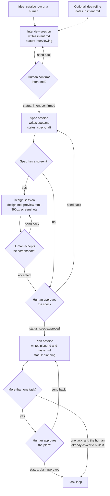
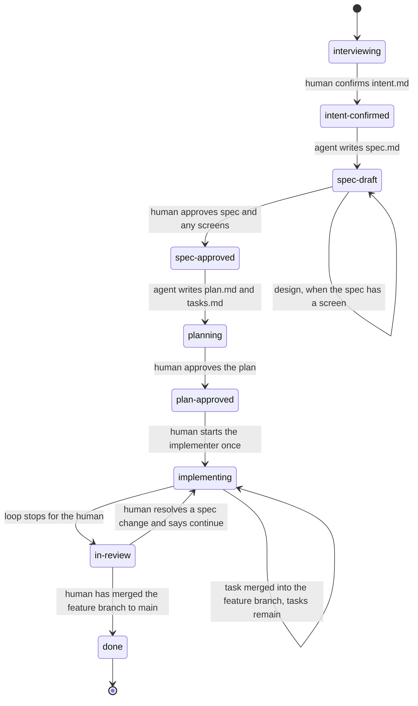
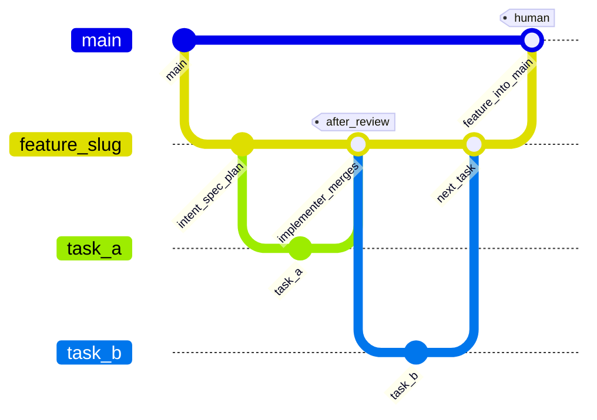
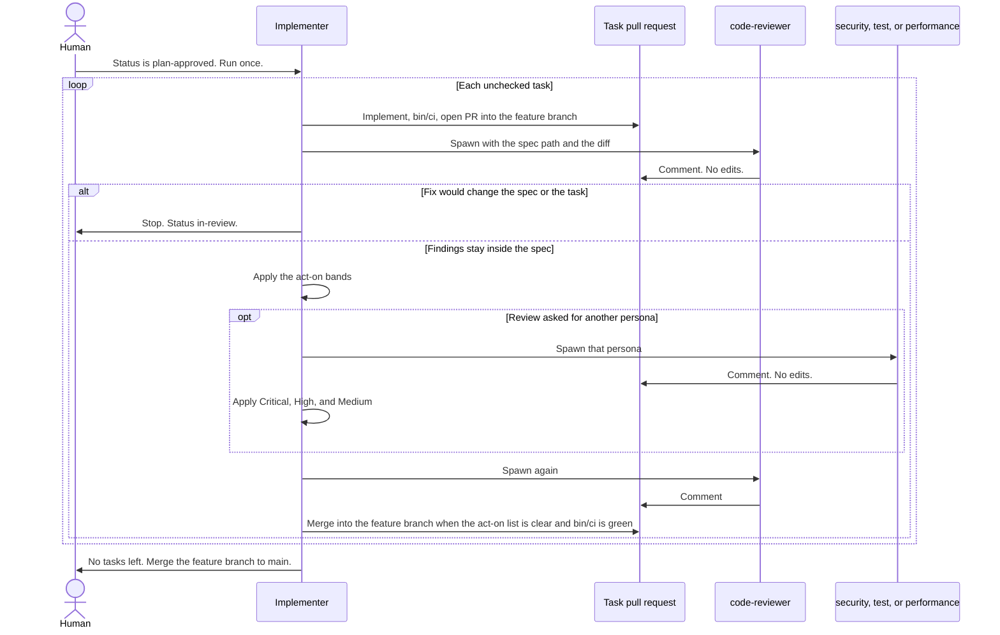

# Feature flows

How a feature moves through sessions, status, and git. The gates are in [operating-model.md](operating-model.md) and `.cursor/skills/repo-workflow/SKILL.md`. The paste-in prompts are in [prompts.md](prompts.md). The task loop is [ADR-0007](../decisions/0007-run-the-task-loop-without-per-task-gates.md).

The human starts interview, spec, design, and plan. After `plan-approved`, one implementer runs every remaining task.

## Sessions through plan approval

`idea-refine` is optional. It writes notes in `intent.md` until the human picks a direction. Status stays `interviewing`.

Design runs only when `spec.md` describes a screen. It writes `design.md`, `design/preview.html`, and 390px screenshots. A picture that changes behavior is written back into `spec.md` in that same session. The human accepts the screenshots, then approves the spec. Status stays `spec-draft` until that approval.

A plan with more than one task stops for approval. A single small task may be implemented in a later turn of the same session only when the spec is already approved and the human asked to build it.

## Status

Set `Status` in the feature `README.md` to one of these. `parked` is allowed from any state, with a reason in that README.

Only a human sets `intent-confirmed`, `spec-approved`, `plan-approved`, or `done`. An agent may set `spec-draft`, `planning`, `implementing`, and `in-review`.

`implementing` covers the whole task loop, including task pull requests and their merges. `in-review` means the loop stopped for the human. The README says which of the three stops it was: the spec or the task would have to change, the same act-on finding survived one fix attempt, or no tasks remain.

`parked` can be entered from any state above. The README says why.

## One task, one pull request

The feature branch is `feature/<slug>`. Enrolment's is `feature/enrolment`, still ahead of `main`. Each task is a short-lived branch and one pull request into that feature branch. The implementer opens it, runs the review loop below, and merges it. Pull requests [#7](https://github.com/usamah82/sokong/pull/7) and [#8](https://github.com/usamah82/sokong/pull/8) merged into `feature/enrolment`. [#4](https://github.com/usamah82/sokong/pull/4) and [#5](https://github.com/usamah82/sokong/pull/5) merged into `cursor/record-product-answers`; `feature/enrolment` continues that line.

The human merges `feature/<slug>` into `main` after the last task. A merge to `main` still leaves production deploy as its own request. Hosting is undecided.

A checkpoint in `tasks.md` is checked after the tasks above it are on the feature branch. It does not get a pull request. A failed check that stays inside the spec is a commit on the feature branch. A failed check that needs a spec change stops the loop.

A typo, a failing test for already-accepted behavior, or a dependency bump does not need a feature folder. That change names the existing spec or ADR and can target `main`. Dependabot pull requests target `main`.

Tasks run one at a time, in `tasks.md` order. A note in `plan.md` that two tasks can run in either order does not start a second implementer.

## Review inside the task

The implementer follows `incremental-implementation` and `test-driven-development`, runs `bin/ci`, and opens the pull request. It then spawns `code-reviewer`. That persona reads `spec.md` and the diff, comments on the pull request, and does not edit the branch.

The implementer acts on Critical and Required from `code-reviewer`. It leaves Optional and Nit. When that review asks for another pass, the implementer spawns the named persona and acts on Critical, High, and Medium, leaving Low:

- `security-auditor` when the diff needs a security pass
- `test-engineer` when coverage is short
- `web-performance-auditor` when performance needs a pass

After the fixes, it spawns `code-reviewer` once more. It merges the task pull request when that pass has nothing left in the act-on bands and `bin/ci` is green. It checks the task and takes the next one. Status stays `implementing`.

It stops, sets `in-review`, and writes the reason in the feature README when:

- a finding can be fixed only by changing `spec.md` or that task's acceptance
- the same act-on finding is still open after one fix attempt
- no unchecked tasks remain

On the last of those, the human merges the feature branch to `main` and sets `done`.

A local SDK agent for this loop uses `Agent.create` with `local: { cwd, settingSources: ["project"] }` and a model id. The personas in `.cursor/agents/*.md` are the subagents. The parent spawns them with the Agent tool, so the `task` tool stays allowed. Cloud `autoCreatePR` targets the default base, which is the wrong base for these pull requests. The Run prompt is the way to start the loop. A wrapper script is not in the repo.

## What stays a separate session

| Hop | Session writes | Then stop |
|---|---|---|
| Interview | `intent.md` | Human confirms |
| Spec | `spec.md` | Human approves, after design when there is a screen |
| Plan | `plan.md`, `tasks.md` | Human approves when more than one task remains |
| Run | Every remaining task, merged into the feature branch | A spec change, a stuck finding, or no tasks left |
| Feature branch to `main` | — | Human merges, then sets `done` |
| Deploy | — | Human asks, after an ADR names a host |
